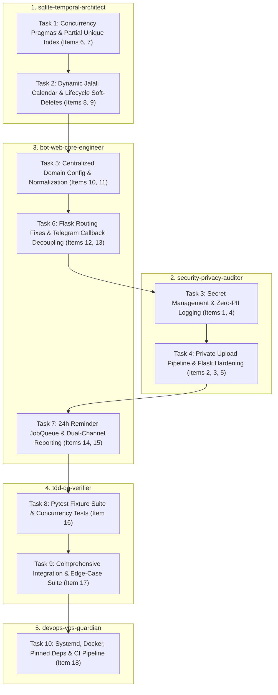

# Comprehensive 18-Point Architecture & Hardening Implementation Plan

> **For agentic workers:** REQUIRED SUB-SKILL: Use superpowers:subagent-driven-development (recommended) or superpowers:executing-plans to implement this plan task-by-task. Steps use checkbox (`- [ ]`) syntax for tracking.

**Goal:** Refactor and harden `psychology_bot` into a production-grade, secure, and concurrent hybrid Flask web application, Telegram bot service, and reporting engine across all 18 audit items.

**Architecture:** Split monoliths into clean, decoupled layers driven by 5 specialized sub-agents: centralized domain configuration (`config.py`), concurrency-safe SQLite database with partial unique slot indexing (`database.py`), hardened Flask web routes and private uploads (`app.py`), modular Telegram bot callback routing and reminders (`main.py`), automated dual-channel reporting (`daily_report.py`), isolated `pytest` test suite (`tests/`), and production deployment configs (`deploy/`, `.github/`).

**Tech Stack:** Python 3.12+, Flask 3.0+, `python-telegram-bot` 21+, `jdatetime`, `Pillow`, `python-dotenv`, `Flask-WTF`, `pytest`, `pytest-asyncio`, SQLite (WAL mode), Gunicorn, Systemd, Docker.

**Spec:** Sub-agent definitions in `.agents/skills/` and repository audit specifications.

## Global Constraints
- Operating System: Ubuntu Linux VPS (production) / Windows (development workspace).
- Timezone: `Asia/Tehran` for all appointment calculations, logs, and reporting.
- Calendar: Jalali (`jdatetime`) without hardcoded year constants.
- Privacy & PII: Zero patient full names, telephone numbers, or free-text clinical notes in application logs.
- Security: Zero secrets or live passwords in version control. All receipts stored in `private_uploads/` with UUID names and verified image magic bytes.
- Concurrency: SQLite configured with WAL mode and partial unique index on active appointments.

## Review Focus
1. Double-booking race condition under concurrent requests attempting the exact same slot.
2. Malicious/forged receipt upload bypassing extension checks (mitigated by Pillow verification).
3. Secret leakage or PII logging during error conditions and state transitions.
4. Jalali year rollover edge cases across Nowruz (1405 -> 1406+).
5. Authorization bypass on admin callbacks (`approve_`/`reject_`) or client cancellations (`user_cancel_`).

---

## Sub-Agent Task Mapping

---

### Task 1: SQLite WAL Mode, Pragmas & Engine-Level Slot Uniqueness
**Assigned Sub-Agent:** `sqlite-temporal-architect`
**Audit Items Covered:** Item 6 (WAL mode & pragmas), Item 7 (TOCTOU elimination & partial unique index).
**Files:**
- Modify: `database.py`
- Test: `tests/test_database.py`

- [ ] **Step 1: Write failing tests for SQLite WAL mode, pragmas, and partial unique slot index**
  - Verify `PRAGMA journal_mode` returns `wal`.
  - Verify `PRAGMA busy_timeout` returns `30000`.
  - Verify `PRAGMA foreign_keys` returns `1`.
  - Verify inserting two appointments on the same `(date, time)` with `status='pending'` or `'confirmed'` raises `SlotAlreadyBookedError`.
- [ ] **Step 2: Run test to confirm failure**
- [ ] **Step 3: Implement centralized connection factory and schema migration in `database.py`**
  - Configure `PRAGMA journal_mode=WAL;`, `PRAGMA busy_timeout=30000;`, `PRAGMA synchronous=NORMAL;`, `PRAGMA foreign_keys=ON;`.
  - Define custom domain exception `SlotAlreadyBookedError(Exception)`.
  - Add partial unique index:
    `CREATE UNIQUE INDEX IF NOT EXISTS idx_appointments_active_slot ON appointments(date, time) WHERE status IN ('pending', 'approved', 'confirmed');`
  - Wrap appointment insertion in a `try...except sqlite3.IntegrityError` block and raise `SlotAlreadyBookedError`.
- [ ] **Step 4: Run tests to confirm pass**
- [ ] **Step 5: Commit changes**

---

### Task 2: Dynamic Rolling Jalali Calendar & Soft-Delete Governance
**Assigned Sub-Agent:** `sqlite-temporal-architect`
**Audit Items Covered:** Item 8 (Jalali year-rollover & rolling window), Item 9 (Soft-delete lifecycle & stale expiration).
**Files:**
- Modify: `database.py`
- Create/Modify: `config.py` (temporal logic)
- Test: `tests/test_temporal.py`

- [ ] **Step 1: Write failing tests for dynamic working days and appointment expiration**
  - Test rolling business day generator across Nowruz boundary (e.g. starting at `1405/12/28` transitioning to `1406/01/05`).
  - Test that hardcoded `1405` constants are nowhere in date generation.
  - Test `expire_stale_pending_appointments(cutoff_hours=2)` marking overdue pending bookings as `expired`.
- [ ] **Step 2: Run test to confirm failure**
- [ ] **Step 3: Implement rolling Jalali calendar generator and lifecycle helpers**
  - Implement `get_upcoming_working_days(days_count=5, is_admin=False, reference_date=None)` anchored to `ZoneInfo("Asia/Tehran")`.
  - Add `created_at` and `updated_at` columns (ISO-8601 in `Asia/Tehran`).
  - Implement `expire_stale_pending_appointments(timeout_hours=2)` in `database.py`.
- [ ] **Step 4: Run tests to confirm pass**
- [ ] **Step 5: Commit changes**

---

### Task 3: Secrets Management, .env Loading & Zero-PII Logging
**Assigned Sub-Agent:** `security-privacy-auditor`
**Audit Items Covered:** Item 1 (Secret isolation & .env), Item 4 (Zero-PII logging & warning log levels).
**Files:**
- Create: `.env.example`
- Modify: `daily_report.py`, `app.py`, `main.py`, `.gitignore`
- Test: `tests/test_security.py`

- [ ] **Step 1: Write failing tests asserting no hardcoded secrets and sanitized logs**
  - Assert `daily_report.SENDER_PASSWORD` is read from `os.environ`.
  - Assert `app.secret_key` is read from `os.environ` without fallback to static secrets.
  - Assert logging output does not contain patient names or phone numbers when booking actions occur.
- [ ] **Step 2: Run test to confirm failure**
- [ ] **Step 3: Implement secret isolation and logging sanitization**
  - Add `python-dotenv` loading to `config.py`.
  - Remove hardcoded credentials from `daily_report.py`, `app.py`, `main.py`.
  - Scrub all `logger.info` calls: replace `f"نام: {full_name}"` with `user_id={user_id}, app_id={app_id}`.
  - Set `logging.getLogger("httpx").setLevel(logging.WARNING)` and `logging.getLogger("telegram").setLevel(logging.WARNING)`.
  - Ensure `.gitignore` ignores `.env`, `*.db*`, `private_uploads/`.
- [ ] **Step 4: Run tests to confirm pass**
- [ ] **Step 5: Commit changes**

---

### Task 4: Private Upload Storage, Pillow Image Verification & CSRF Protection
**Assigned Sub-Agent:** `security-privacy-auditor`
**Audit Items Covered:** Item 2 (Flask production settings & CSRF), Item 3 (Private upload & Pillow validation), Item 5 (RBAC authorization).
**Files:**
- Modify: `app.py`, `main.py`
- Test: `tests/test_upload_security.py`

- [ ] **Step 1: Write failing tests for image verification, private storage, and RBAC**
  - Test uploading a fake image (e.g. text file named `receipt.jpg`) fails with HTTP 400.
  - Test valid image is saved to `private_uploads/` with a UUID4 filename and verified bytes.
  - Test admin callback from unauthorized user ID returns error and mutates no database state.
  - Test client cancellation for another user's appointment ID is rejected.
- [ ] **Step 2: Run test to confirm failure**
- [ ] **Step 3: Implement secure upload pipeline and authorization guards**
  - Move upload target from `static/uploads/` to `private_uploads/` (outside web root).
  - Implement `save_verified_receipt(file_stream)`:
    - Validate file size <= `5MB`.
    - Run Pillow `Image.open(file_stream).verify()`.
    - Re-encode image to clean RGB JPEG/PNG to strip EXIF and polyglots.
    - Save under `private_uploads/{uuid4().hex}.jpg`.
  - Add `CSRFProtect(app)` to Flask and `MAX_CONTENT_LENGTH = 5 * 1024 * 1024`.
  - Enforce `user_id in ADMIN_IDS` on `approve_` and `reject_` callbacks.
  - Enforce `appointment.user_id == current_user.id` on `user_cancel_`.
- [ ] **Step 4: Run tests to confirm pass**
- [ ] **Step 5: Commit changes**

---

### Task 5: Centralized Domain Configuration & Unified Request Validation
**Assigned Sub-Agent:** `bot-web-core-engineer`
**Audit Items Covered:** Item 10 (Centralized `config.py`), Item 11 (Unified validation & Persian numeral normalization).
**Files:**
- Create: `config.py`
- Modify: `app.py`, `main.py`
- Test: `tests/test_validation.py`

- [ ] **Step 1: Write failing tests for digit normalization and unified validation**
  - Test `normalize_digits("۰۹۱۲۳۴۵۶۷۸۹")` returns `"09123456789"`.
  - Test `validate_booking_request` with regular user attempting today or tomorrow returns `(False, "advance_notice_required")`.
  - Test `validate_booking_request` with admin attempting today or tomorrow returns `(True, "ok")`.
  - Test `validate_booking_request` with invalid Iranian mobile returns `(False, "invalid_phone")`.
- [ ] **Step 2: Run test to confirm failure**
- [ ] **Step 3: Implement `config.py` with unified constants and validation**
  - Unify `ADMIN_IDS`, `WORKING_HOURS`, `WORKING_WEEKDAYS`, `MIN_ADVANCE_DAYS`, `CANCELLATION_HOURS_LIMIT`.
  - Implement `normalize_digits(text: str) -> str`.
  - Implement `validate_booking_request(date_str, time_str, full_name, phone, is_admin)`.
  - Refactor `app.py` and `main.py` to import constants and validators from `config.py`.
- [ ] **Step 4: Run tests to confirm pass**
- [ ] **Step 5: Commit changes**

---

### Task 6: Flask Route Separation & Modular Telegram Callback Routing
**Assigned Sub-Agent:** `bot-web-core-engineer`
**Audit Items Covered:** Item 12 (Flask unstacked route architecture), Item 13 (Modular callback query handlers).
**Files:**
- Modify: `app.py`, `main.py`
- Test: `tests/test_web_routes.py`, `tests/test_bot_handlers.py`

- [ ] **Step 1: Write failing tests for Flask routing and modular bot callback dispatch**
  - Test `GET /` routes to `home()` returning `index.html`.
  - Test `GET /about` routes to `about()` returning `about.html`.
  - Test admin callback query is handled by modular `admin_approval_callback`.
- [ ] **Step 2: Run test to confirm failure**
- [ ] **Step 3: Refactor Flask routing and Telegram handlers**
  - Fix unstacked decorators in `app.py`: `@app.route('/')` on `home()`, `@app.route('/about')` on `about()`.
  - Replace monolithic `button_handler` in `main.py` with separate handlers:
    - `CallbackQueryHandler(admin_approval_callback, pattern=r"^approve_\d+$")`
    - `CallbackQueryHandler(admin_rejection_callback, pattern=r"^reject_\d+$")`
    - `CallbackQueryHandler(user_cancel_callback, pattern=r"^user_cancel_\d+$")`
    - `CallbackQueryHandler(date_callback, pattern=r"^date_")`
    - `CallbackQueryHandler(time_callback, pattern=r"^time_")`
    - `CallbackQueryHandler(type_callback, pattern=r"^type_")`
    - `CallbackQueryHandler(main_menu_callback, pattern=r"^main_menu$")`
- [ ] **Step 4: Run tests to confirm pass**
- [ ] **Step 5: Commit changes**

---

### Task 7: JobQueue 24-Hour Client Reminders & Dual-Channel Reporting
**Assigned Sub-Agent:** `bot-web-core-engineer`
**Audit Items Covered:** Item 14 (Automated 24h reminders), Item 15 (Dual-channel daily report).
**Files:**
- Modify: `main.py`, `daily_report.py`, `database.py`
- Test: `tests/test_reminders_and_reports.py`

- [ ] **Step 1: Write failing tests for 24-hour reminder job and dual-channel reporting**
  - Test reminder query fetches confirmed appointments occurring within next 24 hours where `reminder_sent = 0`.
  - Test running reminder job sends reminder message to patient and flags `reminder_sent = 1`.
  - Test `daily_report.py` dispatches both to SMTP email and Telegram admin broadcast.
- [ ] **Step 2: Run test to confirm failure**
- [ ] **Step 3: Implement reminder job queue and dual-channel report**
  - Add `reminder_sent INTEGER DEFAULT 0` column to `appointments` table.
  - Implement `send_24h_reminders(context)` registered in `app.job_queue.run_repeating(..., interval=3600)`.
  - Update `daily_report.py` to broadcast report summary to `ADMIN_IDS` via Telegram Bot API alongside the HTML email.
- [ ] **Step 4: Run tests to confirm pass**
- [ ] **Step 5: Commit changes**

---

### Task 8: Pytest Fixtures, Mock Framework & Concurrency Conflict Tests
**Assigned Sub-Agent:** `tdd-qa-verifier`
**Audit Items Covered:** Item 16 (Pytest framework & conftest).
**Files:**
- Create: `tests/conftest.py`
- Modify: `tests/`
- Test: `pytest`

- [ ] **Step 1: Setup `conftest.py` with isolated database and client fixtures**
  - Create `db_conn` fixture yielding an isolated SQLite connection per test using `tmp_path`.
  - Create `flask_client` fixture providing `app.test_client()`.
  - Create `mock_bot` fixture for Telegram Bot context.
- [ ] **Step 2: Write multi-threaded concurrency booking test**
  - Fire simultaneous booking requests on the same slot; verify exactly 1 succeeds and 1 gets `SlotAlreadyBookedError` / HTTP 409.
- [ ] **Step 3: Run pytest to verify all fixtures and concurrency tests pass**
- [ ] **Step 4: Commit changes**

---

### Task 9: Comprehensive Integration & Edge-Case Test Suite
**Assigned Sub-Agent:** `tdd-qa-verifier`
**Audit Items Covered:** Item 17 (Full test coverage of validation, security, and temporal logic).
**Files:**
- Create/Modify: `tests/test_full_suite.py`
- Test: `pytest -v`

- [ ] **Step 1: Implement comprehensive integration tests**
  - Web booking flow from `GET /booking` through `POST /booking`.
  - Persian numeral input sanitization.
  - Spoofed receipt upload rejection.
  - Nowruz boundary date generation.
  - 48-hour cancellation cutoff enforcement.
  - Multi-admin receipt deletion and notification flow.
- [ ] **Step 2: Run full test suite: `pytest -v`**
- [ ] **Step 3: Verify 100% passing tests with zero warnings**
- [ ] **Step 4: Commit changes**

---

### Task 10: Production Deployment Hardening, Systemd, Docker & CI/CD
**Assigned Sub-Agent:** `devops-vps-guardian`
**Audit Items Covered:** Item 18 (DevOps & VPS hardening).
**Files:**
- Create: `deploy/systemd/psychobot-web.service`
- Create: `deploy/systemd/psychobot-bot.service`
- Create: `deploy/systemd/psychobot-report.service`
- Create: `deploy/systemd/psychobot-report.timer`
- Create: `Dockerfile`
- Create: `docker-compose.yml`
- Create: `.github/workflows/ci.yml`
- Modify: `requirements.txt`
- Test: Lint and docker build / CI simulation

- [ ] **Step 1: Pin dependencies in `requirements.txt`**
  - Add exact versions for `Flask`, `python-telegram-bot`, `jdatetime`, `Pillow`, `python-dotenv`, `Flask-WTF`, `gunicorn`, `pytest`, `pytest-asyncio`, `requests`.
- [ ] **Step 2: Author systemd service and timer files in `deploy/systemd/`**
  - `psychobot-web.service` (Gunicorn binding to unix socket or `127.0.0.1:5000`).
  - `psychobot-bot.service` (`python main.py` with `Restart=on-failure`).
  - `psychobot-report.service` & `psychobot-report.timer` (nightly at 21:00 Tehran time).
- [ ] **Step 3: Author `Dockerfile` and `docker-compose.yml`**
  - Non-root user, persistent volume mounts for database and `private_uploads/`.
- [ ] **Step 4: Author GitHub Actions CI workflow `.github/workflows/ci.yml`**
  - Runs `pytest` on pushes and pull requests.
- [ ] **Step 5: Verify build files and commit**
